# Aula Virtual LPR — Proyecto Final LPR07304

**Estudiante:** Félix Arocha · **Profesora:** Ing. María Valentina García · Universidad José Antonio Páez · Octubre 2026

Plataforma web para la materia *Lenguajes de Programación* construida con **4 microservicios** (Python, Node.js, Java y Go), **PostgreSQL**, **MongoDB**, **Docker Compose** y **Nginx como API Gateway**.

## ¿Qué hace el sistema?

Una plataforma de clases con tres tipos de cuenta, como una web normal:

- **Cualquiera se registra** como **estudiante** o **profesor** con nombre, **cédula**, correo y clave, y **confirma su correo con un código de 6 dígitos** que le llega de verdad (vence en 10 minutos, máximo 5 intentos). También hay **"¿Olvidaste tu clave?"** (otro código al correo) y la casilla **"Recordarme"** (sesión de 30 días).
- En **Mi perfil** (clic en tu nombre arriba a la derecha) cada quien puede poner una **foto** y contar algo de sí mismo: sobre mí, qué estudia, semestre, edad y si trabaja. **Todo es opcional.** Los **profesores ven el perfil y la foto de los estudiantes inscritos en sus secciones** (botón *Ver perfil* en la lista de la sección), y de nadie más. Desde ahí también se puede **eliminar la cuenta** (pide la clave otra vez; el administrador no puede eliminarse). Si un profesor elimina su cuenta, **se borran también sus materias** con sus secciones, temas y presentaciones.
- Los **profesores** quedan en una **lista de espera** hasta que el **administrador general** los aprueba (recibe un aviso y los aprueba o rechaza desde su panel; al profesor le llega un correo con la decisión).
- Cada **profesor** crea **sus propias materias, secciones y horarios**. Solo él ve y modifica lo suyo.
- El **estudiante** abre **"Inscribirme"**: el catálogo muestra los profesores con sus materias y las secciones con su horario, y **solicita inscripción**. El profesor ve en su inicio las **solicitudes pendientes** con el **nombre, la cédula y el correo** del estudiante y las **aprueba o rechaza**; el estudiante recibe la respuesta (campanita y correo).
- El profesor organiza los temas por semana y **sube su presentación** (PDF o PPTX). Cada tema se publica a **todas las secciones de la materia o solo a las que elija**; el estudiante solo ve las clases de las secciones donde fue aprobado.
- La **IA** lee cada diapositiva y escribe una **explicación**. El profesor puede corregirla antes de publicar (en el visor con el botón *Editar* o en la pestaña *Editar explicaciones*).
- Al publicar, la IA genera **preguntas distintas para cada estudiante** (el profesor elige cuántas, de 1 a 20; por defecto 5). Ningún estudiante recibe una pregunta que tenga otro. El profesor puede corregir cualquier pregunta mientras el estudiante no haya entregado.
- **Clases privadas con lista de asistencia:** el profesor marca la clase como "Solo asistentes" y **pasa lista por sección** (con nombre, cédula y correo de cada alumno). Solo los presentes reciben acceso, sus preguntas y una notificación.
- **Visor de diapositivas:** el estudiante ve la diapositiva real junto a la explicación de la IA y avanza con ← →. Los PPTX se convierten a PDF en el servidor con LibreOffice.
- **"Pregúntale a la IA":** un botón pequeño abajo a la derecha abre un chat que conoce la diapositiva que el estudiante está viendo. El profesor ve en **"Dudas a la IA"** qué preguntó cada alumno, en qué diapositiva y qué le respondió la IA.
- Los estudiantes **responden** y entregan; el profesor de esa clase ve todas las respuestas y recibe el aviso.
- **Notificaciones** con campanita en la web y **por correo** (códigos, solicitudes, aprobaciones, clase nueva, preguntas asignadas, entregas).
- El **administrador general** también puede activar o desactivar cuentas: una cuenta desactivada **pierde el acceso al instante** en los 4 servicios.
- La página **"Cómo lo construimos"** (`https://localhost/como-lo-hicimos.html`) explica cada requisito de la Clase 12 con el código real y muestra el estado de los servicios en vivo.

## Arquitectura

> Por qué elegimos esta arquitectura y cómo fue evolucionando: [docs/arquitectura.md](docs/arquitectura.md)

```
                         ┌──────────────────────────┐
                         │   Navegador (Frontend)   │
                         └────────────┬─────────────┘
                                      │ https://localhost
                         ┌────────────▼─────────────┐
                         │ Nginx — API Gateway :443 │  HTTPS; sirve frontend/ y enruta /api/*
                         └──┬────────┬────────┬─────┘
          /api/auth/        │        │        │        /api/notificaciones/
        ┌───────────────────┘   /api/ia/  /api/clases/ └──────────────────┐
        │                            │        │                           │
┌───────▼────────┐  ┌────────────────▼─┐  ┌───▼──────────────┐  ┌─────────▼────────┐
│ auth · Python  │◄─┤  ia · Node.js    │◄─┤ clases · Java    │  │ notificaciones   │
│ FastAPI        │  │  Express         │─►│ Spring Boot      │  │ · Go (Gin)       │
│ SQLAlchemy     │─►│  Mongoose        │  │ Spring Data JPA  │  │ GORM + SMTP      │
└───────┬────────┘  └──────┬─────┬─────┘  └────────┬─────────┘  └─────▲───┬────────┘
        │                  │     └── notificar ────┼─────────────────►│   │
        │                  │                       │                  │   │ correo
┌───────▼──────────────────┼───────────────────────▼──────────────────┴┐  ▼
│ PostgreSQL 15:  auth_db · clases_db · notif_db                       │ Mailpit
└──────────────────────────┼───────────────────────────────────────────┘ :8025
                    ┌──────▼──────┐          ┌─────────────────────────┐
                    │ MongoDB 7   │          │ IA externa: NVIDIA NIM  │
                    └─────────────┘          │ o Google Gemini         │
                                             └─────────────────────────┘
```

Redes de Docker: `backend` (bases de datos, Mailpit y servicios) y `frontend` (gateway y servicios). El gateway **no** tiene acceso a las bases de datos.

## Microservicios

| Servicio | Lenguaje | Puerto | Base de datos / ORM | Endpoints principales (vía gateway) |
|---|---|---|---|---|
| `servicio-auth` | Python 3.12 · FastAPI | 8000 (solo red interna) | PostgreSQL `auth_db` · SQLAlchemy | `POST /api/auth/registro`, `/registro/verificar`, `/registro/reenviar`, `POST /api/auth/login`, `/recuperar`, `/recuperar/confirmar`, `GET/DELETE /api/auth/me`, `GET/PUT /api/auth/me/perfil`, `GET/PUT/DELETE /api/auth/me/foto`, `GET /api/auth/usuarios/:id/perfil\|foto`, `GET /api/auth/admin/profesores`, `POST …/admin/profesores/:id/aprobar\|rechazar`, `GET/PATCH/DELETE /api/auth/admin/usuarios` |
| `servicio-ia` | Node.js 20 · Express | 3000 (solo red interna) | MongoDB `aula_ia` · Mongoose | `GET/PUT /api/ia/clases/:id/contenido`, `GET/POST /api/ia/clases/:id/consultas`, `GET/PUT /api/ia/clases/:id/mis-preguntas`, `GET /api/ia/clases/:id/respuestas` |
| `servicio-clases` | Java 21 · Spring Boot 3 | 8080 (solo red interna) | PostgreSQL `clases_db` · Spring Data JPA | `GET/POST/PUT/DELETE /api/clases/materias`, `POST /api/clases/materias/:id/secciones`, `DELETE /api/clases/secciones/:id/estudiantes/:eid`, `GET /api/clases/catalogo`, `POST/GET /api/clases/solicitudes`, `PUT /api/clases/solicitudes/:id`, `GET/POST/PUT/DELETE /api/clases/temas`, `POST /api/clases/temas/:id/presentacion`, `POST /api/clases/temas/:id/publicar`, `PUT /api/clases/temas/:id/configuracion`, `GET /api/clases/temas/:id/diapositivas.pdf` |
| `servicio-notificaciones` | Go 1.25 · Gin | 8080 (solo red interna) | PostgreSQL `notif_db` · GORM | `GET /api/notificaciones/`, `PATCH /api/notificaciones/:id/leida`, `POST /api/notificaciones/leer-todas` |
| `gateway` | Nginx | **443** en el host (el 80 redirige a HTTPS) | — | Frontend + `/api/*` |
| `mailpit` | — | 8025 en el host | — | Bandeja de correos de prueba |

El gateway es el **único punto de entrada** a la aplicación: desde fuera de Docker solo se llega a él (y a Mailpit, la bandeja de correos de prueba, que no forma parte de la aplicación). Los microservicios y las bases de datos solo existen en la red interna de Docker, así que toda petición pasa por HTTPS, la verificación de sesión y el límite de intentos de Nginx.

Todos exponen `GET /health` (desde fuera, a través del gateway: `/api/<servicio>/health`).

### Comunicación entre microservicios

Las llamadas internas usan el nombre del servicio como host (`http://servicio-ia:3000`) y el header `X-Internal-Token`:

| Origen → Destino | Para qué |
|---|---|
| Java → Node | `POST /interno/procesar`: envía la presentación subida para que la IA la explique |
| Node → Java | `PATCH /interno/temas/:id/estado`: avisa que terminó (BORRADOR) o falló (ERROR) |
| Java → Node | `POST /interno/asignar`: al publicar, generar las 5 preguntas por estudiante |
| Node → Python | `GET /usuarios?rol=…`: nombre y correo de los estudiantes con acceso o del profesor dueño (ruta solo interna) |
| Node → Go | `POST /interno/notificar`: campanita + correo a cada estudiante / al profesor dueño de la clase |
| Python → Java | `DELETE /interno/estudiantes/:id`: sacar de sus secciones a un estudiante eliminado |
| Python → Java | `DELETE /interno/profesores/:id`: borrar las materias de un profesor eliminado (antes de borrar su cuenta) |
| Python → Java | `GET /interno/profesores/:pid/estudiantes/:eid`: ¿el estudiante está en una sección del profesor? (para dejarle ver su perfil) |
| Java → Node | `POST /interno/asignar` cada vez que cambian las secciones, la lista o se aprueba a un estudiante: Java calcula quién tiene acceso (`permitidos`) y el profesor dueño |
| Python → Go | `POST /interno/correo`: **código de verificación** y de recuperación de clave (síncrono: si el correo no sale, el usuario lo sabe) |
| Python → Go | `POST /interno/notificar`: avisar a los admins de un profesor nuevo y al profesor de la decisión |
| Java → Go | `POST /interno/notificar`: avisar al profesor de una solicitud y al estudiante de su respuesta |

Además los 4 servicios validan el mismo **JWT** firmado con `SECRET_KEY`, y **Nginx le pregunta a Python en cada petición** si la cuenta del token sigue activa (`auth_request`): un usuario desactivado o eliminado recibe 401 al instante en todos los servicios. Las rutas `/interno/*` están **cerradas en el gateway** (404 desde el navegador).

## Cómo ejecutarlo

Requisitos: Docker Desktop (o Docker Engine + Compose v2).

```bash
git clone <URL-del-repositorio>
cd proyecto-final-felix-arocha
cp .env.example .env
docker compose up --build
```

La primera vez tarda unos minutos (Maven descarga dependencias de Java). Cuando todo esté *healthy*:

| Qué | URL |
|---|---|
| Plataforma | https://localhost |
| Cómo lo construimos + estado en vivo | https://localhost/como-lo-hicimos.html |
| Bandeja de correos (Mailpit) | http://localhost:8025 |

**Administrador general:** el que esté en `ADMIN_EMAIL` / `ADMIN_PASSWORD` del `.env` (por defecto `admin@ujap.edu.ve` / `Admin2026!`). Es la única cuenta que existe al empezar: los profesores y estudiantes se **registran solos** desde la pantalla de ingreso. Los códigos de verificación llegan al correo (con el SMTP por defecto, a la bandeja de Mailpit).

> **HTTPS y certificado.** El gateway sirve la plataforma por HTTPS (puerto 443) con un certificado **autofirmado** que se genera al construir la imagen, y el puerto 80 redirige a HTTPS. La primera vez el navegador mostrará *"Tu conexión no es privada"*: pulsa **Avanzado → Continuar a localhost** (es normal con certificados locales; en producción se usaría uno real, por ejemplo de Let's Encrypt). Con `curl` usa la opción `-k`.
>
> Si el puerto 80 o el 443 están ocupados en su computadora, cambie `"80:80", "443:443"` por `"8080:80", "8443:443"` en el servicio `gateway` del `docker-compose.yml` y entre a https://localhost:8443 (ajuste también `PUBLIC_URL`).

## Configuración (`.env`)

El repositorio solo incluye `.env.example`; el `.env` real está en `.gitignore`.

### Inteligencia Artificial

El sistema funciona **sin API key** en *modo demo* (explicaciones y preguntas generadas por plantillas). Para usar IA real:

**Opción A — NVIDIA NIM (gratis, por defecto)**
1. Entrar a https://build.nvidia.com e iniciar sesión.
2. Abrir cualquier modelo (p. ej. *gemma-4-31b-it*) → **Get API Key**. La key empieza con `nvapi-`.
3. En el `.env`:
   ```
   IA_PROVIDER=nvidia
   NVIDIA_API_KEY=nvapi-xxxxxxxx
   NVIDIA_MODEL=google/gemma-4-31b-it
   ```

**Opción B — Google Gemini**
1. Crear una key en https://aistudio.google.com/apikey
2. En el `.env`:
   ```
   IA_PROVIDER=gemini
   GEMINI_API_KEY=AIza...
   ```

Después de cambiar el `.env`: `docker compose up -d` (recrea los servicios con la nueva configuración). Si una clase se procesó en modo demo, use **"Regenerar con IA"** en la clase.

### Correo

El sistema **envía correos de verdad** (códigos de verificación, recuperación de clave, solicitudes y avisos). Por defecto los manda a **Mailpit** (http://localhost:8025), una bandeja de prueba: así se puede evaluar todo sin configurar nada, leyendo el código ahí.

**¿Por qué Mailpit por defecto y no una cuenta de Gmail ya configurada?** Porque este repositorio es público y una contraseña SMTP publicada permite a cualquiera enviar correos como esa cuenta (y Google la bloquearía). Además, así el sistema se evalúa sin configurar nada: el código de verificación se lee en http://localhost:8025. El servicio de notificaciones usa SMTP estándar, así que pasar a Gmail, Outlook u otro proveedor es cambiar cinco variables del `.env`, sin tocar el código.

Para que lleguen a bandejas reales (por ejemplo Gmail):

1. En tu cuenta de Google activa la **verificación en 2 pasos** y crea una **contraseña de aplicación** (Cuenta de Google → Seguridad → Contraseñas de aplicaciones).
2. Edita el `.env` (con el puerto **587**; el 465 no funciona con este servicio):

```
SMTP_HOST=smtp.gmail.com
SMTP_PORT=587
SMTP_USER=sucorreo@gmail.com
SMTP_PASS=<contraseña de aplicación de 16 letras>
SMTP_FROM=Aula Virtual LPR <sucorreo@gmail.com>
```

3. `docker compose up -d` (recrea los servicios con la nueva configuración).

**Cómo se comprueba que el correo es real** (en tres pasos):

1. **Dominio:** antes de crear la cuenta, el servicio de auth consulta el DNS (registros MX) y rechaza dominios que no existen o no reciben correo, como `nombre@gmail.con`. Si el DNS no responde, deja pasar el registro.
2. **Envío:** si el SMTP no puede enviar el mensaje, el registro responde con un error claro y no deja la cuenta creada.
3. **Código:** que el buzón exista y sea de quien se registra solo lo prueba el código de 6 dígitos (Gmail no permite preguntar si un buzón existe). Sin el código la cuenta no entra.

Si alguien escribe mal su correo (Gmail lo acepta y rebota después), puede volver a registrarse con la misma cédula: el registro sin verificar se descarta y no bloquea la cédula.

### Seguridad

Cambie `SECRET_KEY` (mínimo 32 caracteres), `INTERNAL_TOKEN`, `DB_PASS` y `ADMIN_PASSWORD`. Si cambia `DB_USER`/`DB_PASS` actualice también las tres `DATABASE_URL_*`.

Lo que ya protege el sistema:

- Claves con **bcrypt**; los códigos de correo se guardan **hasheados**, vencen en 10 minutos y se bloquean a los 5 intentos fallidos.
- Al recuperar la clave **no se puede repetir una clave ya usada** (ni la actual ni las anteriores): se guarda el historial de sus hashes bcrypt y se compara solo después de validar el código, para que nadie sin el código pueda probar claves.
- **Un profesor solo ve y modifica lo suyo** (materias, secciones, temas, solicitudes, respuestas y dudas): los demás reciben 403.
- El gateway **limita a 10 intentos por minuto** el ingreso, el registro y la recuperación de clave (responde 429).
- Una cuenta **desactivada o eliminada pierde el acceso al instante**, aunque tenga un token vigente.
- Las rutas `/interno/*` solo existen entre servicios (404 desde el navegador) y además exigen el `INTERNAL_TOKEN`.
- Un estudiante solo recibe los datos que le corresponden (sin listas de asistentes, sin temas sin publicar).

> Las bases de datos se crean la primera vez que se crea el volumen. Para empezar de cero: `docker compose down -v`.

## Recorrido sugerido para evaluar

Necesitas tres navegadores o ventanas distintas (una normal y dos de incógnito) para tener varias sesiones a la vez.

1. **Profesor:** pestaña *Registrarse* → rol **Profesor** → llena los datos → el código de 6 dígitos llega a Mailpit (http://localhost:8025) → escríbelo. Queda *en lista de espera*.
2. **Administrador** (`admin@ujap.edu.ve`): en **Administración** aparece el profesor → **Aprobar**. El profesor recibe un correo.
3. **Profesor:** inicia sesión → **Secciones** → *+ Nueva materia* → *+ Sección* con su horario.
4. **Estudiante:** *Registrarse* (con su cédula) → confirma el código → **Inscribirme** → elige la sección del profesor → *Solicitar inscripción*.
5. **Profesor:** en **Clases** aparece **Solicitudes pendientes** con nombre, cédula y correo → **Aprobar**. El estudiante recibe la notificación.
6. **Profesor:** *+ Nuevo tema* (en su materia) → arrastra la presentación (PDF o PPTX) → espera a que la IA termine → revisa las explicaciones → **Publicar**.
   - Opcional: **🔒 Solo asistentes** y **Pasar lista**.
7. **Estudiante:** **Mis clases** → abre la clase → **Ver clase** (diapositivas y **Pregúntale a la IA**) → **Mis preguntas** → responde y entrega.
8. **Profesor:** campanita con la entrega, pestañas **Respuestas de estudiantes** y **Dudas a la IA**.
9. **Probar la recuperación de clave y la desactivación:** *¿Olvidaste tu clave?* en el ingreso; y en **Administración** → *Desactivar* a un estudiante con la sesión abierta: en su siguiente acción lo manda al ingreso.

## Estructura del repositorio

```
proyecto-final-felix-arocha/
├── .env.example              variables de entorno (copiar a .env)
├── docker-compose.yml        orquesta los 8 contenedores
├── nginx/nginx.conf          API Gateway
├── postgres/init.sql         crea una BD por microservicio
├── frontend/                 HTML/CSS/JS (login, plataforma, "cómo lo construimos")
├── servicio-auth-python/     FastAPI + SQLAlchemy + bcrypt + JWT
├── servicio-ia-node/         Express + Mongoose + NVIDIA/Gemini
├── servicio-clases-java/     Spring Boot + Spring Data JPA + LibreOffice (PPTX → PDF)
└── servicio-notificaciones-go/  Gin + GORM + SMTP
```

## Capturas

### Frontend

| Login | Clases del profesor |
|---|---|
| 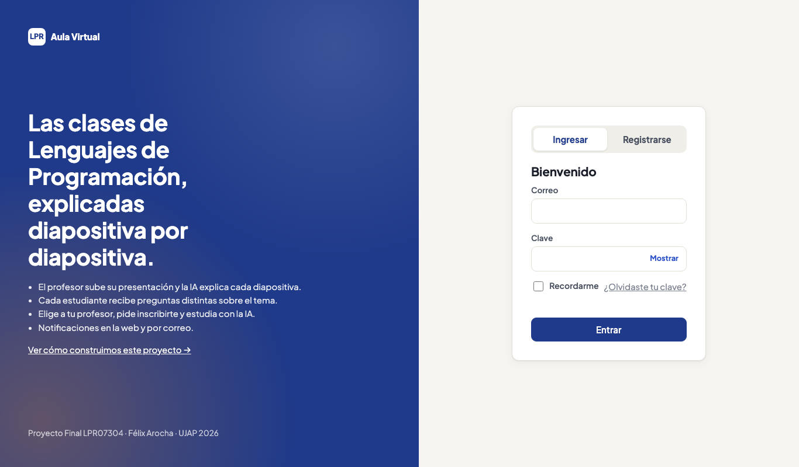 | 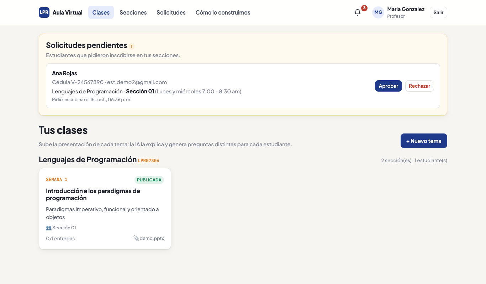 |

| Visor de diapositivas con la explicación de la IA | Chat "Pregúntale a la IA" |
|---|---|
| 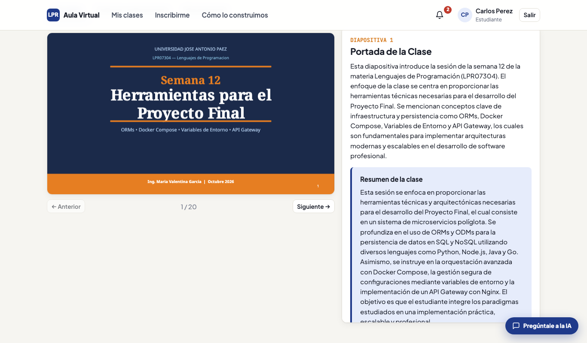 | 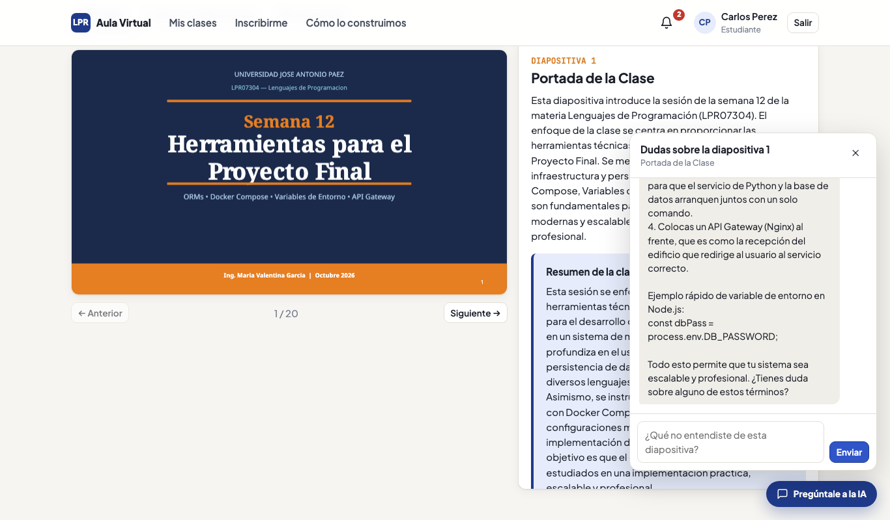 |

| Materias y secciones | Pasar lista por sección |
|---|---|
| 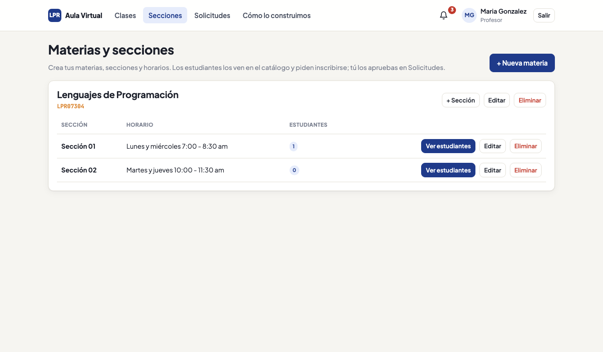 | 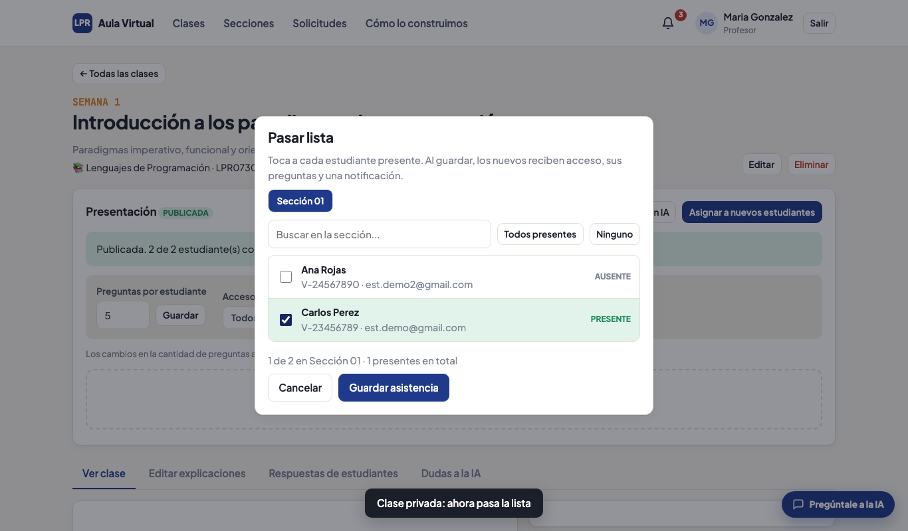 |

| Preguntas del estudiante | Dudas a la IA (vista del profesor) |
|---|---|
| 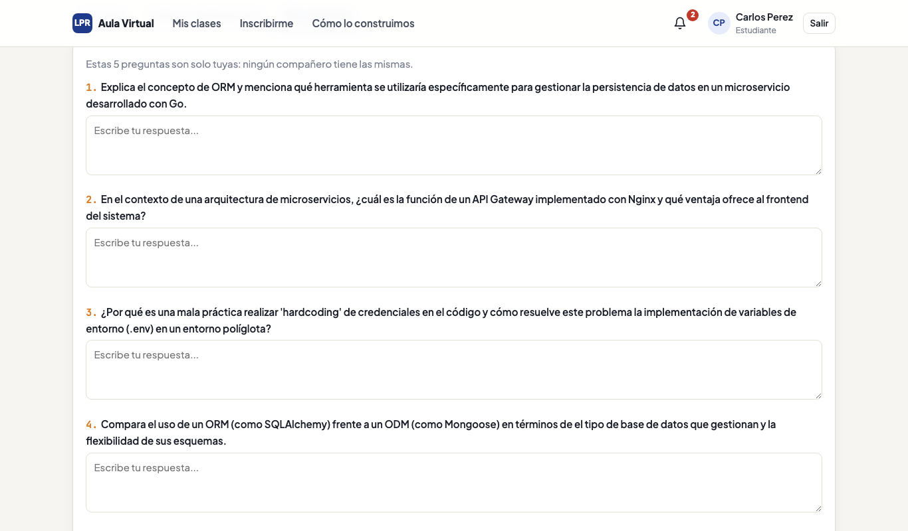 | 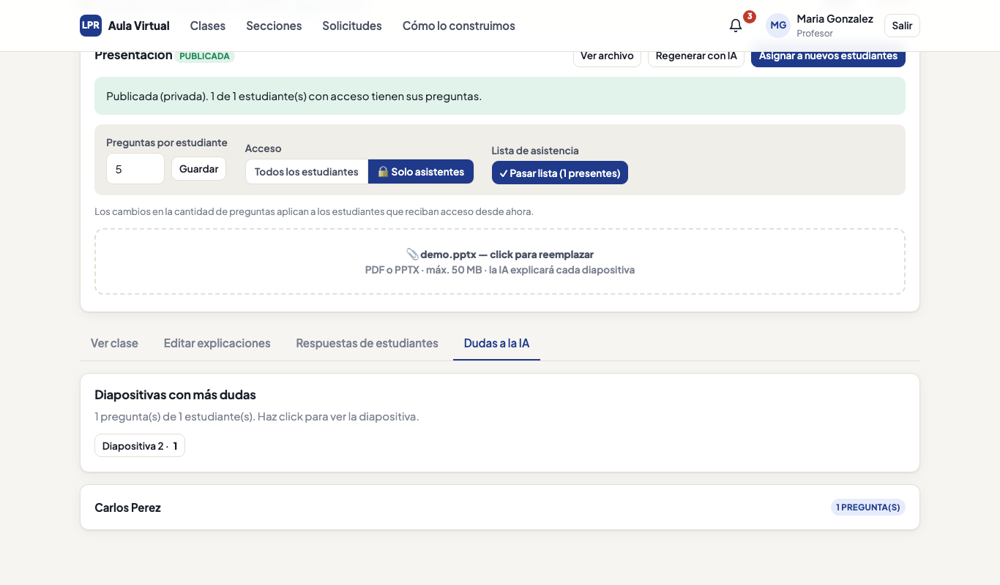 |

| Notificaciones (campanita) | Correos en Mailpit |
|---|---|
| 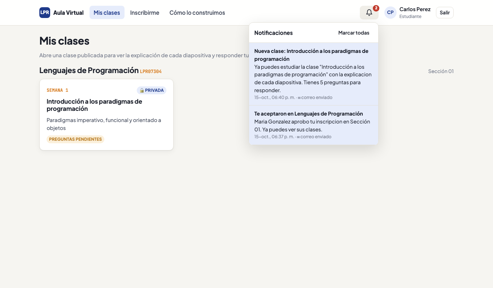 | 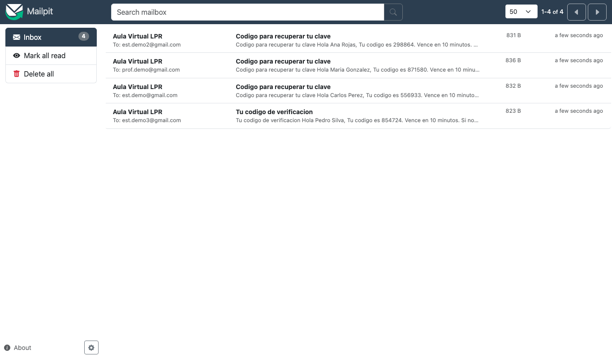 |

### Registro, aprobación e inscripción

| Código de verificación (6 casillas) | Panel del administrador |
|---|---|
| 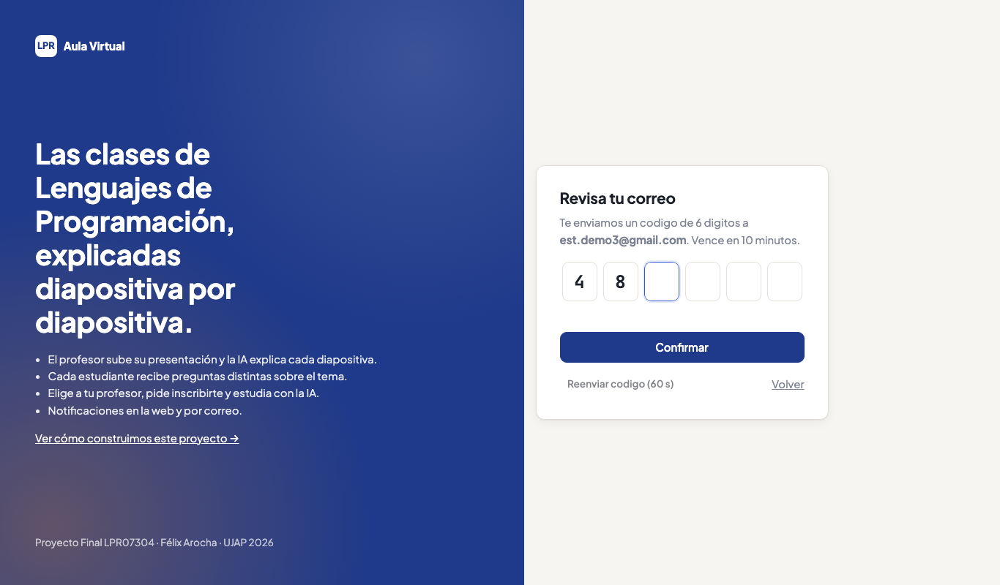 | 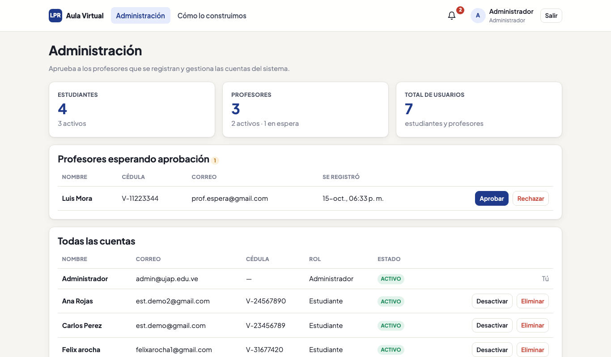 |

| Catálogo "Inscribirme" | Solicitudes del profesor (nombre, cédula y correo) |
|---|---|
| 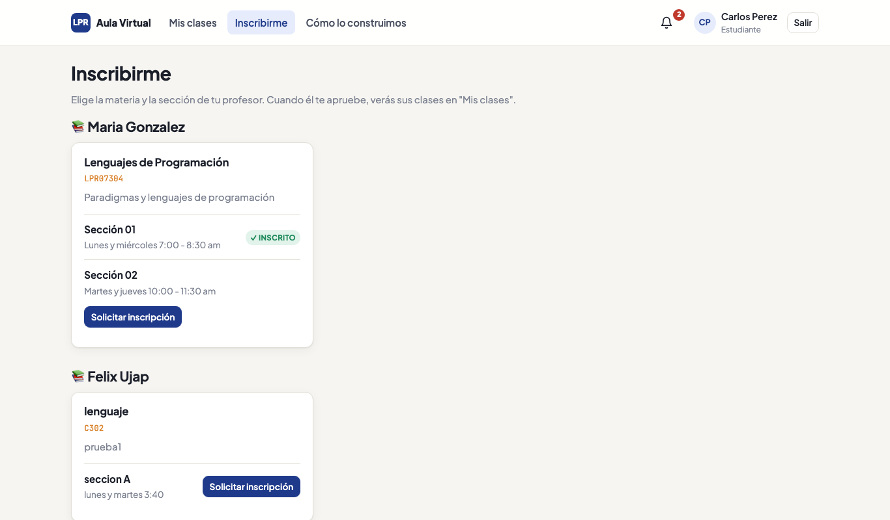 | 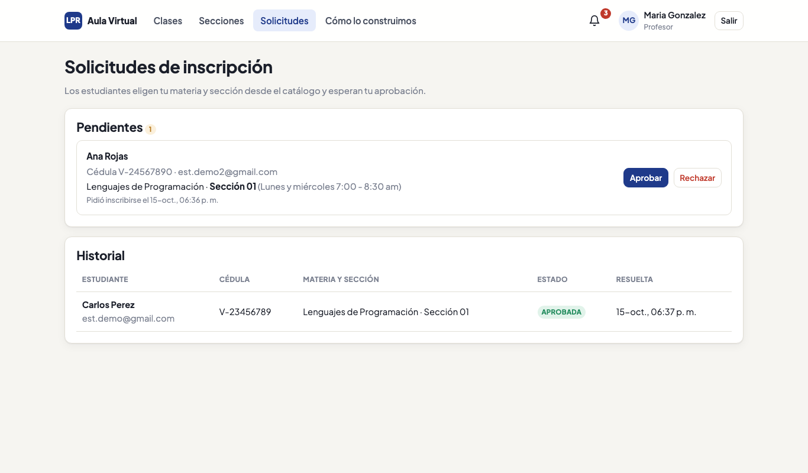 |

### Servicios respondiendo

Estado de los 4 microservicios consultado en vivo a través del gateway (`/api/<servicio>/health`):

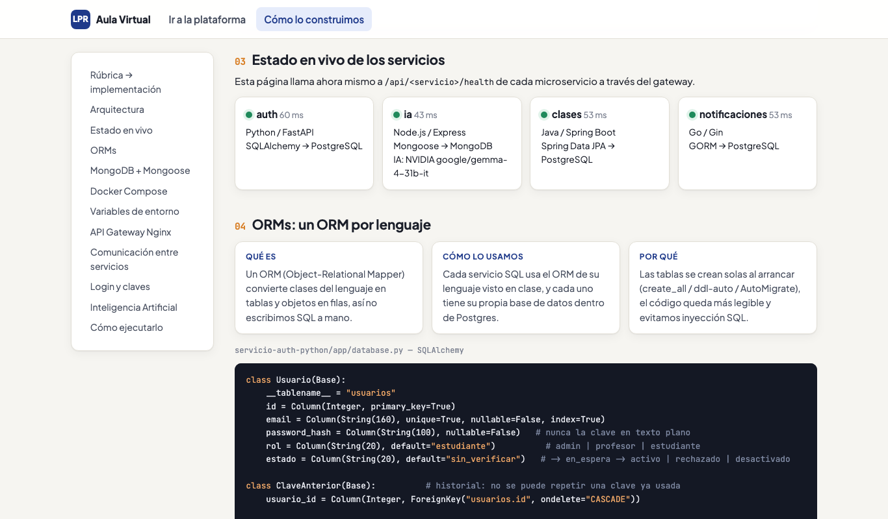

Las mismas respuestas desde la terminal:

```bash
curl -k https://localhost/api/auth/health
curl -k https://localhost/api/ia/health
curl -k https://localhost/api/clases/health
curl -k https://localhost/api/notificaciones/health
```

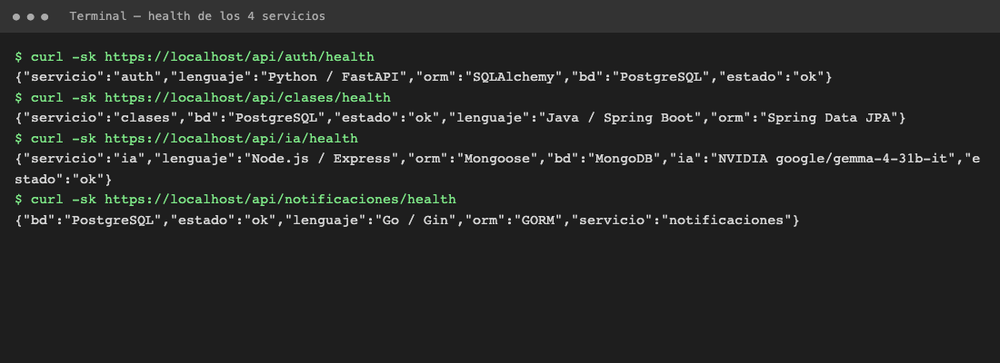

### Contenedores en ejecución

```bash
docker compose ps
```

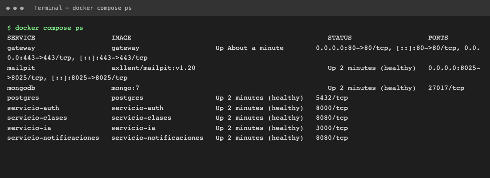
